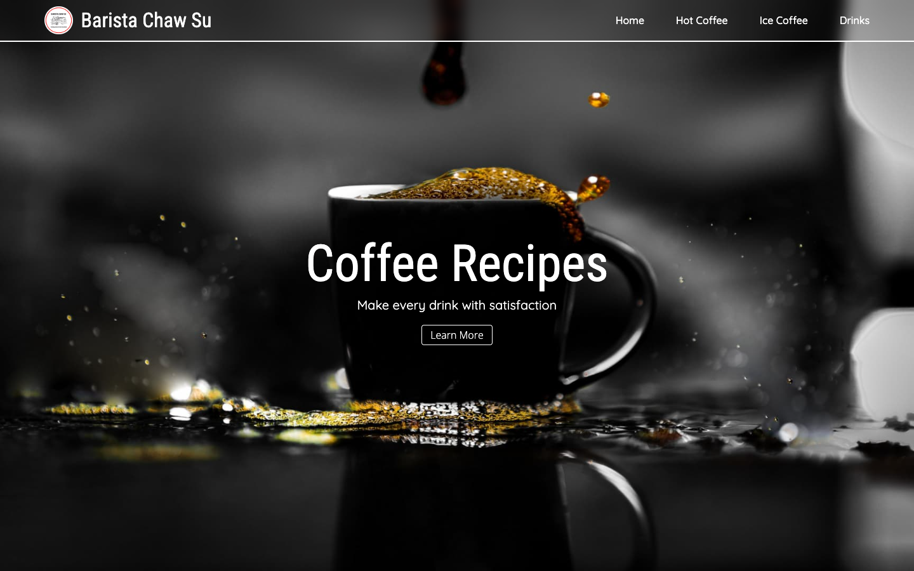

# Barista Chaw Su

A coffee and drink recipe site built with Astro and React in September 2023. It groups recipes into hot coffee, iced coffee and other drinks, and each recipe has its own page.

**Live site:** https://barista.julianzaw.me



## Status

Complete.

## What it does

- Lists recipes in a grid for each category.
- Gives each drink its own page under `src/pages/Drinks/`, such as matcha tea, mojito and peach soda.
- Uses AVIF images for faster loading.

## Tech stack

- Astro with React components
- Sass, MUI and Framer Motion
- Vercel for hosting

## Run it locally

```bash
npm install
npm run dev
```

Astro serves the site at http://localhost:4321.
